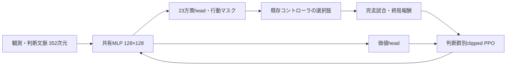

# PPOの設計と実装

Kaggricultureの長期的な生産・売買判断を、既存エージェントの実行可能な選択肢に接続して学習したv25実験を紹介します。公開版では実験で使ったネットワーク・損失・更新処理を取り出し、CPUで動作確認できるようにしています。ゲームに接続する当時のコードも読み物として保存しています。

## 読む順序

| ファイル | 確認できること |
| --- | --- |
| [`ppo/model.py`](../ppo/model.py) | Actor–Critic、行動マスク、判断群別のclipped PPO損失、重みの書き出し |
| [`ppo/update.py`](../ppo/update.py) | 完走軌跡の検査、advantage正規化、ミニバッチ更新、KLによる早期停止 |
| [`ppo/smoke.py`](../ppo/smoke.py) | 合成データによる実際のPPO更新 |
| [`experiments/v25/`](../experiments/v25/README.md) | ゲームへの制御口、特徴量、並列ロールアウト、元の学習ループ |
| [`RESULTS.md`](RESULTS.md) | 学習規模、評価条件、結果と不採用の理由 |
| [`ppo_provenance.json`](ppo_provenance.json) | 抽出元コミット・ファイルハッシュ・公開版での変更範囲 |

## 状態・行動・報酬

- **状態：352次元。** 全体情報288次元と判断時の文脈64次元。公開の農場・市場・店舗、自分の在庫・観測履歴を使用。相手の非公開在庫、未来の店舗、環境seedは入力しません。
- **ネットワーク：128×128のtanh MLP。** 共有特徴から23個のカテゴリ方策head（計159 logits）と価値headを出力します。
- **行動：既存制御の部分置換。** 生産経路、追加投資、商品ごとの売却・予約、作付け、家畜、施肥、労働計画を選択。無効な候補はマスクします。全ターンの原始行動をゼロから生成する構成ではありません。
- **報酬：終局の勝ち+1／引分0／負け−1。** 完走軌跡を使用し、γ=λ=1のためadvantageは終局returnと価値推定の差です。公開した更新コードに汎用のGAE再帰計算はありません。



## 更新の工夫

PPOの比率は各headの新旧方策確率から計算し、0.8〜1.2でclipします。23head全体の同時確率を一度にclipする方式ではありません。判断頻度が大きく異なるため、経路・投資・市場・農作業・労働の5群を各1/5で集計します。判断がない群は0として扱い、他の群の比重を増やしません。

価値損失は二乗誤差の1/2、entropyは有効な選択肢数で正規化します。4epoch、Adamの学習率3e−4、勾配ノルム上限0.5、近似KLが0.03を超えたらその更新を停止する構成です。旧実装では停止を起こしたKL自体が平均ログに含まれない点があり、結果の解釈で制約として扱っています。

ゲーム側では128完走試合ごとに更新し、対戦収集中の重みを固定しました。CPU推論とPyTorch更新のlog probability差を更新前に確認します。無効な試合を黙って除外すると経験分布が変わるため、異常があればバッチを使わず停止します。

## 動作確認

Python 3.12と、`requirements-ppo.txt` の依存を使用します。

```bash
python3.12 -m venv .venv
.venv/bin/python -m pip install -r requirements-ppo.txt
.venv/bin/python -m ppo.smoke
.venv/bin/python -m unittest discover -s tests -v
```

smokeは正負の終局報酬を持つ**合成2軌跡・64サンプル**で実際に重みを更新します。出力の `synthetic_data: true` と `game_performance_evaluated: false` が示すとおり、ゲームの勝率や学習成功を測る実験ではありません。既存実験の学習規模・結果と混同しないよう分離しています。

テストは群別損失の手計算、非active headの勾配、行動マスク、重みの保存・復元、有限な重み更新を確認します。

## 再現できる範囲

この公開版でそのまま再現できるのは、ネットワーク・PPO損失・更新処理の数値的な動作です。完全な対戦再学習には、元のv24、固定した公開相手、C++シミュレータ、当時の設定・データ・学習済み重みが必要です。これらの大きな成果物や権利確認が必要な取得物は同梱していません。

`experiments/v25` は元のディレクトリ構成を前提とした参照ソースであり、この公開版で直接実行する入口ではありません。そこでの相対パスや外部モジュールを、公開版の依存が揃っていることの根拠にしないでください。新たな長時間学習やKaggle提出も自動では行いません。

抽出元コミットは監査用の出典識別子です。元の開発リポジトリが非公開の場合、外部から原本を閲覧することはできません。公開版には比較用のファイルハッシュと抽出範囲を収録しています。
